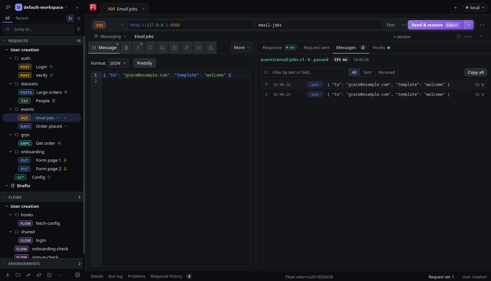
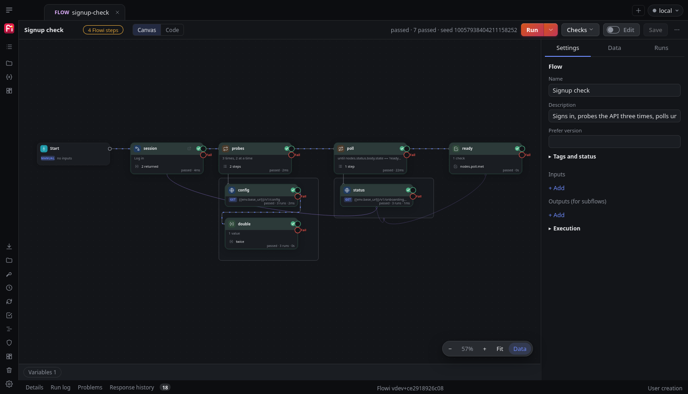
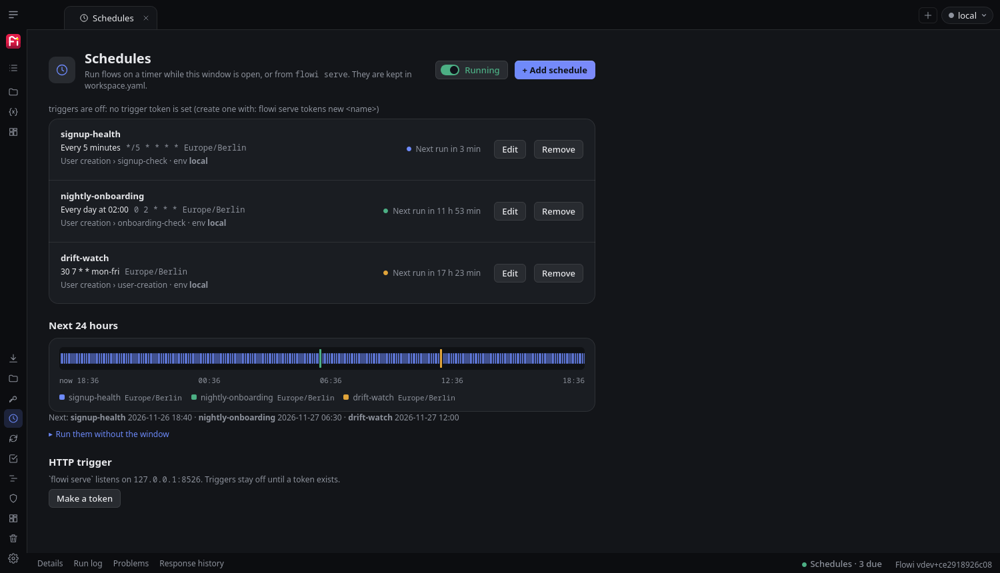
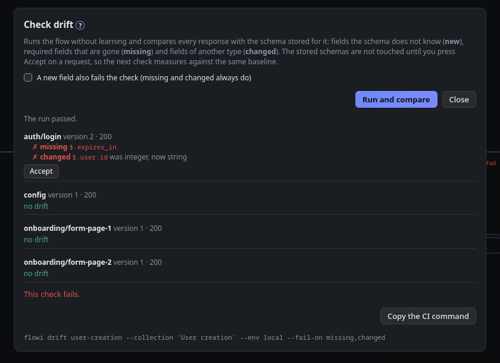
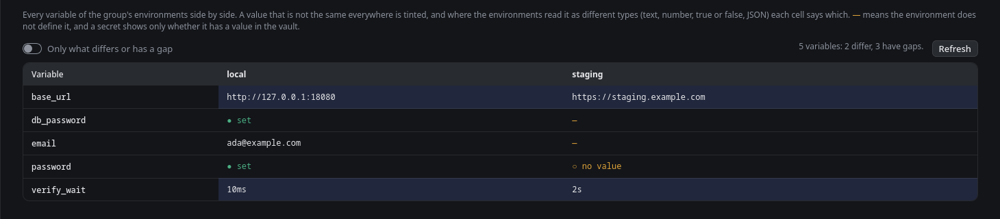

# Flowi

**A fast desktop app for testing APIs of every kind, and for chaining the calls into flows.** HTTP, gRPC, message
brokers, databases and plain data files all use the same editor, the same checks and the same flows. Your work is
plain files in your own git repository, and secrets stay in an encrypted vault on your machine.


## Why Flowi exists

Flowi started as an itch. The author kept running into the limits of the usual API tools:

- **Real checks go past HTTP.** Most of the author's own checks involved more than a request and a response: publish
  an event and wait for the message it causes, look in the database to see what an API wrote, read a queue, call a
  gRPC service. Tools built around the HTTP request make each of these a workaround.
- **Full-cycle flows were too spread out.** Running a whole journey (log in, create something, wait for the event,
  check the row, clean up) meant stitching scripts, collections and CI jobs together. Here it is one picture that runs
  with one click, and the same file runs unchanged in CI.
- **The UI should not feel sluggish.** Popular alternatives are Electron apps and often feel slow, especially with big
  collections. Flowi's core is Go, and the window shows its screens in the system's own web view instead of bundling a
  browser.
- **Git should stay yours, and secrets should stay out of it.** Everything is plain YAML in a normal repository, so
  branches, reviews and merges work the way they do for code. Flowi adds the checks that keep a password or a token from
  being pushed by mistake.
- **The OpenAPI ecosystem has moved on.** There are now overlays, Arazzo for workflows, AsyncAPI for events and
  OpenTelemetry for tracing. Flowi uses them directly instead of inventing its own formats.
- **Tests and scripts should be easy.** Checks on a response are a few clicks (asserts), and for anything more there
  are hooks that run before and after a request.

## What you can do

### Send any kind of request

One request editor covers all of it: `{{templates}}` from environments, secrets and generators, several **versions** of
a request, **hooks** before and after, checks on the answer, values extracted from it, pinned examples, and a history
of responses. The collage above shows six real answers: an HTTP login whose token is extracted for the next step, a
gRPC call to a service found by server reflection, an SQS message sent and read back, a NATS request that waits for the
reply, a PostgreSQL query with a parameter, and a SQL query over a CSV file.


A **message request** can send, receive, or both: it subscribes first, sends, then collects the reply, so nothing is
missed. You choose how many messages to wait for and a timeout, filter them with a condition, and check or extract
values from them exactly as for an HTTP response.



A **flowi overlay** is a named variant you lay over a request when you send it: the same call as a VIP customer, over a
slow connection, or with a bad token. Flowi shows what it changes before it writes anything.

### What it can talk to

| | Supported |
|---|---|
| **HTTP** | `GET`, `POST`, `PUT`, `PATCH`, `DELETE`, `HEAD`, `OPTIONS`, `QUERY`; WebDAV and others (`PROPFIND`, `PROPPATCH`, `MKCOL`, `COPY`, `MOVE`, `LOCK`, `UNLOCK`, `REPORT`, `SEARCH`, `MKCALENDAR`, `VERSION-CONTROL`, `LINK`, `UNLINK`, `PURGE`) and any valid method token of your own |
| **gRPC** | Unary and server-streaming methods, found by server reflection or from `.proto` files; gRPC-Web |
| **Messaging** | WebSocket, Server-Sent Events, MQTT, Kafka, AMQP 0-9-1 (RabbitMQ), AMQP 1.0, NATS, Redis, Amazon SQS, Amazon SNS, Azure Service Bus, Google Pub/Sub |
| **Databases** | PostgreSQL, MySQL, MariaDB, SQLite. Queries only read by default; values are passed as parameters |
| **Data files** | CSV, XLSX and Parquet files, or a folder of them, queried with SQL |
| **Imports** | OpenAPI, AsyncAPI, `.proto`, Arazzo, Postman, Bruno, HAR, `.http` files, curl commands |
| **Exports** | Flows as Arazzo or Mermaid diagrams; OpenAPI and AsyncAPI descriptions generated from your requests; overlays as OpenAPI Overlay documents; run reports as JUnit, JSON and Markdown |

### Build flows on a canvas

Drag steps onto the canvas, wire them together and press Run. A step can be a request, a fetch, a webhook wait, a
subflow, a value setter, an assert, a fuzz run, a condition, a delay, a log or a note. Dotted arcs show which values
pass from one step to the next, and every step turns green or red as it runs. Open any step to see what it sent and
what came back, or run only part of the flow.



The flow above signs in, probes the API three times with a **batch** (the box under `probes`), polls with **run until**
(the box under `poll`) until the answer says `ready`, and then asserts the result. Loops are boxes: the steps inside
repeat, and the run log shows each round. Beyond those there are `parallel`, `stop` and `loop_control` steps for the
rest.

Every step has **outcomes**: success and failure to begin with, and you can add your own, such as "401" or "slow".
Drag from an outcome to the step that should run when it happens, which is how a flow handles a failed login without
stopping. The **Checks** menu runs a flow across a matrix of environments and overlays, checks that another user cannot
reach what the flow made, looks for drift from the responses seen before, and draws a sequence diagram of the last run.

Every flow is also a readable file you can edit in the **Code** view, written as an
[Arazzo](https://spec.openapis.org/arazzo/latest.html) workflow so that other tools can read it.


### Replay and fake APIs

The **replayer** serves your saved responses as a local API, so a front end can work before the back end exists. Point
it at a real API in *record* mode and it forwards each call, saves the answer and turns calls it has not seen into new
requests. It can also misbehave on purpose, to try retries and error handling: answer a share of calls with an error,
drop the connection or add a delay. A single call can ask for it with a header, such as `X-Flowi-Fault: error:418`.


### Schedule runs

Add cron schedules with a time zone and start them from the app, or run them without a window with `flowi serve`.
The same server can start a flow when it receives an HTTP call with a trigger token. The screen shows the next runs on
a 24-hour timeline.



### Start from a blueprint

**Blueprints** are templates: whole flows you can copy and adapt, and hook blueprints for the pre and post steps you
use again and again (sign in first, clean up after). Create a flow or a hook from a blueprint, or save what you built as
one.


### Catch drift before your users do

Flowi learns a schema for each response it sees. **Check drift** runs a flow and compares every response with what was
learned, and sorts the differences into *missing* (a required field is gone), *changed* (a field has another type) and
*new* (a field the schema does not know). Press **Accept** on a request when the change is intended, so the next check
measures against the new baseline. The dialog also gives the command to run the same check in CI.



### Keep the collection in order

Collections can be kept tidy and checked, which is the part that grows more useful with every request you add:

- **Statuses and tags** (`planning`, `in-development`, `review`, `testing`, `production`) on requests, flows and
  folders, inherited from where they sit. Filter the sidebar with `status:` and `tag:`, and group a collection's
  endpoints by path, tag, folder or status.
- **Checks that run while you work**, with codes you can look up: a declared secret with no value, a credential typed
  straight into a request instead of a secret (`FLW-LINT-004`), credentials sent over plain `http` (`FLW-LINT-005`), a
  secret that would be sent to a host it is not allowed for (`FLW-SEC-005`), and secrets in an environment file that
  ships with the collection (`FLW-SEC-006`).
- **Spec lint rules** on imported and generated API descriptions, and warnings when a response carries `Deprecation`
  or `Sunset` headers.
- **Impact, coverage and access checks**: what uses a request and does it still fit, how much of an API description the
  flows use, and whether another user can reach what a flow made.


### And the small things that add up

- **Named authentications.** Define "staging admin" or "partner API" once in the collection's `auths` folder and
  pick it on any request.
- **Environments you can compare.** See every variable of several environments side by side, with the gaps and the
  differences tinted. Secrets only show whether they have a value, never the value.
- **Schema generation.** Responses teach Flowi their schema, and from your requests plus those schemas it can write
  an OpenAPI or AsyncAPI description.
- **OpenTelemetry tracing.** Send traces of your runs to a collector (OTLP over HTTP). It is off by default and never
  includes bodies, headers or secrets.
- **Secrets in a vault.** An encrypted local vault, with the key in the operating system's keychain. Secrets are masked
  everywhere they could show.
- **Import without leaking.** An import shows a preview of every file first and writes nothing until you confirm.
  Credentials become secrets, never text in a file.
- **Drafts and a trash** for experiments, a command palette, themes including a high-contrast one, and a settings
  screen where every setting is explained.



## Install

Download the package for your system from the [releases page](https://github.com/githugt/flowi/releases).

- **macOS:** unzip `flowi-app_*_macos_arm64.zip` and open `flowi-gui.app`. The app is not notarized yet: right-click and choose Open the first time.
- **Windows 10 or later:** run `flowi-app_*_windows_amd64_setup.exe`. The installer is not signed yet, so SmartScreen warns first.
- **Debian 13 or Ubuntu 24.04 or later:** `sudo apt install ./flowi-app_*_linux_amd64.deb`
- **Fedora:** `sudo dnf install ./flowi-app_*_linux_amd64.rpm`
- **Arch, CachyOS, Manjaro:** `sudo pacman -U flowi-app_*_linux_amd64.pkg.tar.zst`

The command is `flowi-app`. To build it yourself, see the [app README](app/README.md), which also lists what the
window needs on Linux.

To try it with data, mount the example collection in [`lib/examples`](lib/examples) (the folder icon in the sidebar)
and start its demo server.

## The command line and the library

The app has two siblings in this repository.

**[`cli/`](cli)** is the `flowi` command, one static binary without cgo. It runs the same collections and flows in CI
or on a server: `flowi send` and `flowi run` (with JUnit, JSON and Markdown reports), `flowi drift`, `flowi impact`,
`flowi coverage`, `flowi access`, `flowi secret check` for a missing secret before a run starts, `flowi import` and
`flowi export` for Arazzo, `flowi serve` for schedules, triggers and the replayer, and `flowi merge-driver install` so
that git can merge flow files.

```bash
go install github.com/githugt/flowi/cli/cmd/flowi@latest
flowi run user-creation --env staging --report junit=report.xml
```

**[`lib/`](lib)** is the core both are built on: collections, requests, flows, transports, the vault and the importers,
with no user interface and no cgo, for embedding in other Go programs. See its [README](lib/README.md) and the
[development guide](lib/docs/development.md).

## Working in the repository

`go.work` links the three modules, so a change in `lib/` shows up in `cli/` and `app/` straight away. From the root:

```bash
just run         # start the app
just check       # tidy, lint and test every module
```

Each part is tagged on its own, with its folder as a prefix: `lib/v0.4.1`, `cli/v0.4.1-alpha.1`,
`app/v0.4.1-alpha.1`. A `cli/` or `app/` tag builds and publishes that part's release.

## Licence

The app and the command line are AGPL-3.0-or-later and the library is Apache-2.0. Each folder's `LICENSE` file applies
to that folder.
