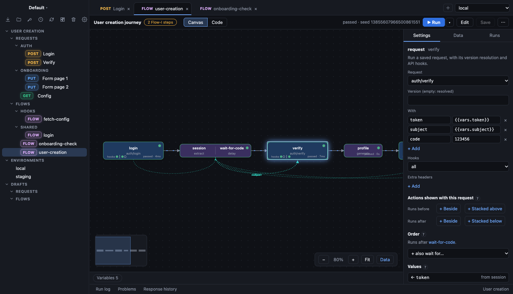
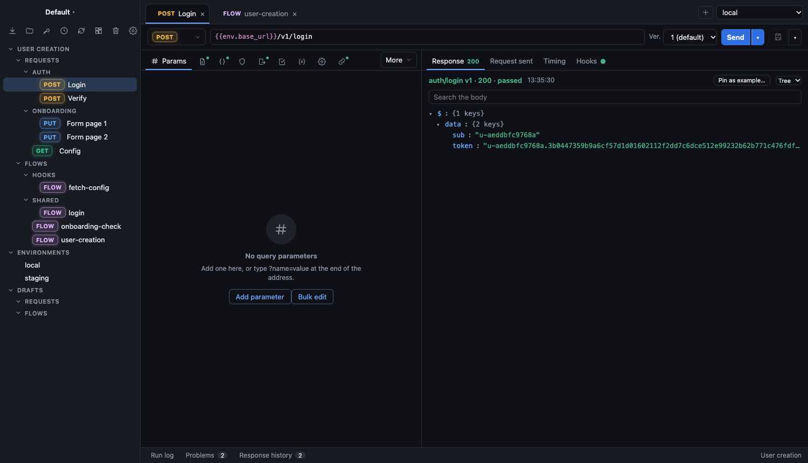
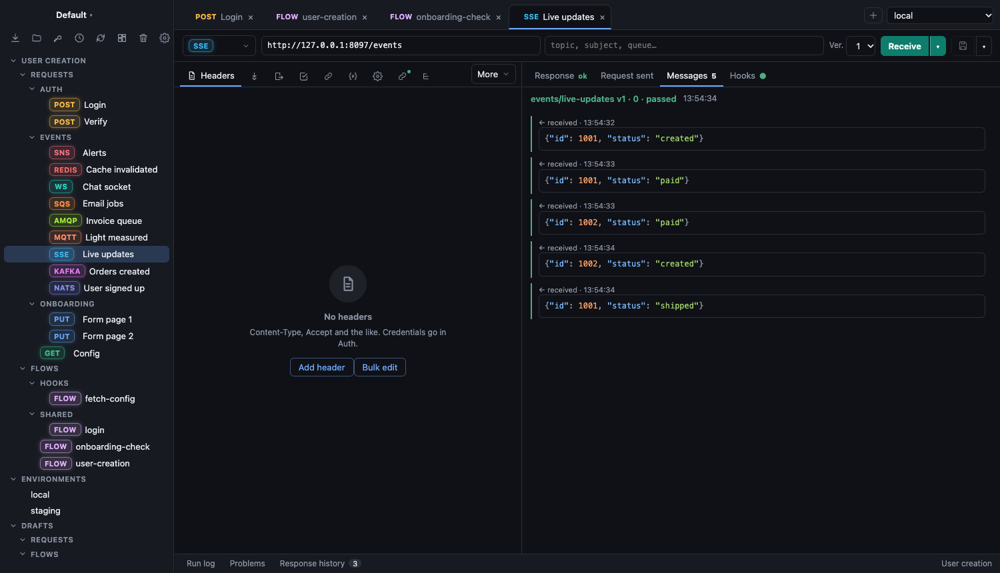
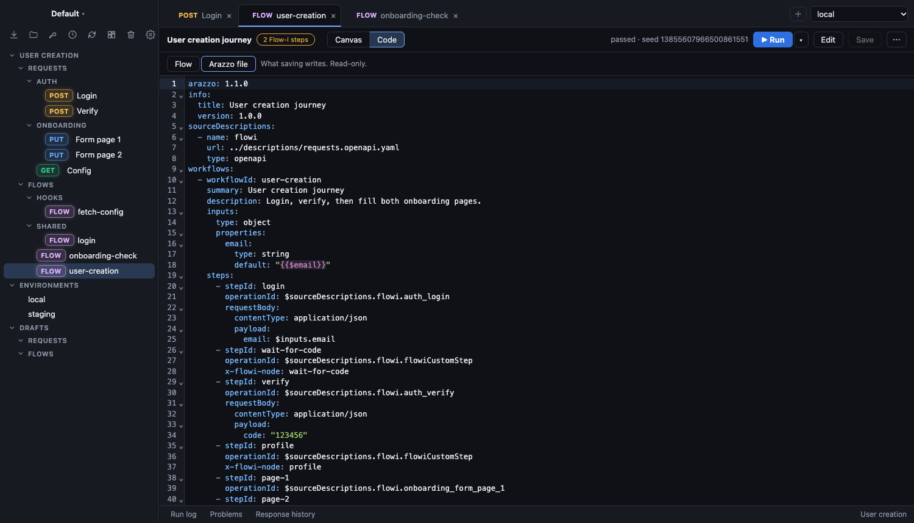
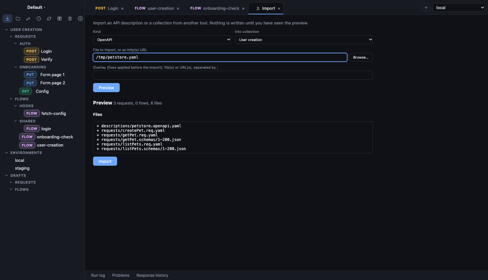
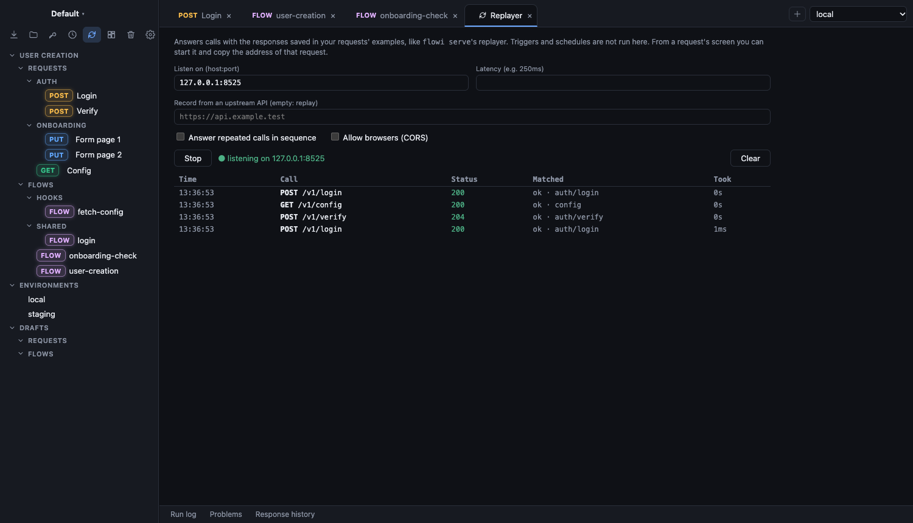
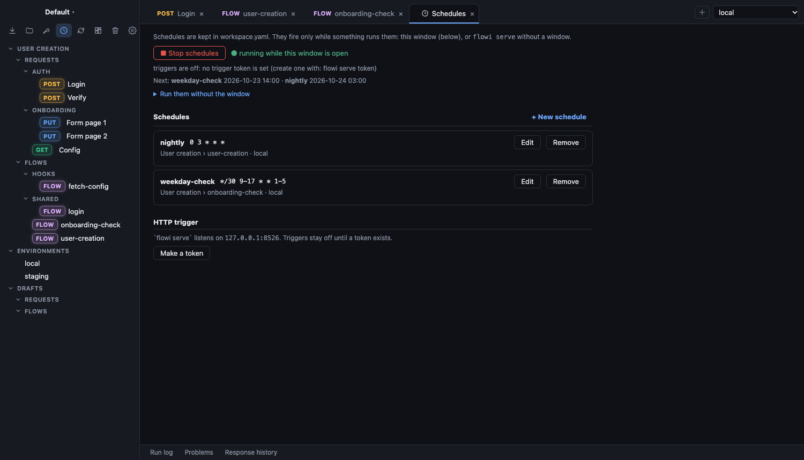

# Flow-I

A desktop app for exploring APIs and stitching requests into **flows**: log in, take the token, verify, fill
in a form, check the result, and run the whole journey with one click. Your work is plain YAML files in your own
git repository; secrets stay in an encrypted local vault.

> Status: **pre-alpha**. The file format and the app will change.



Flow-I is three repositories: this app, the [command-line tool](https://github.com/githugt/flowi-cli) that
runs the same collections in CI, and the [core library](https://github.com/githugt/flowi-lib) both are built on.

## Why

Most API tools stop at the single request. Real work is a sequence, and the sequence is what breaks when an API
changes. Flow-I keeps requests as reusable building blocks, draws the sequences, runs them, and tells you what a
change to a request would break.

## What you can do

### Explore an API

Build and send HTTP and gRPC requests. Use `{{templates}}` from environments, secrets and generators, keep several
**versions** of a request, attach pre and post **hooks**, and pin a response as an example. Responses show as a
tree, with timing, the exact request sent, and a history. Copy a request as curl and other snippets.



### Send and receive messages

Event-driven APIs get the same editor. Publish to or listen on **Kafka, MQTT, AMQP, NATS, Redis, SQS, SNS, Google
Pub/Sub, Azure Service Bus, WebSocket and Server-Sent Events**. A request can send, receive, or both: it
subscribes first, sends, then collects the reply, so nothing is missed. Choose how many messages to wait for and a
timeout, filter them with a condition, and check or extract values from what arrives, exactly as for an HTTP
response. Message requests are steps in flows too: publish an event, then wait for the message it causes.
Each run connects, does its work and closes.



### Build flows on a canvas

Drag steps onto the canvas: request, extract, assert, condition, delay, batch, parallel, run until, subflow and
more. Steps run in order; dotted arcs show which values pass from one step to another. Run the flow and watch each
step turn green or red, then open its response, or run only part of it.

### Arazzo and the file view

Every flow is a readable YAML file you can edit in the **Code** view. The same flow is also written as an
[Arazzo](https://spec.openapis.org/arazzo/latest.html) workflow, so other tools can read it, and Flow-I can
export flows as Arazzo or as a Mermaid diagram for docs.



### Import what you have

Bring in OpenAPI, AsyncAPI, `.proto`, Arazzo, Postman, Bruno, HAR, `.http` files and curl commands. You see a
preview of every file first, and nothing is written until you confirm. Credentials are turned into secrets, never
copied into files.



### Fake an API with the replayer

Serve your saved responses as a local API, so a front end can work before the back end exists. Or point it at a
real API to **record**: it forwards each call, saves the answer, and turns calls it has not seen into new requests.



### Run flows on a schedule

Add cron schedules and start them from the app, or run them without a window with `flowi serve`. Flows can also
be started by an HTTP call.



### And more

Environments and an encrypted **secrets** vault; **impact analysis** of what uses a request; flow **blueprints**
(templates); drafts you can try things in before saving; a trash for abandoned drafts; themes; and a
settings screen where every setting is explained.

## Install and run

You need [Go](https://go.dev/dl/) 1.27 or later, [Node.js](https://nodejs.org/) 22 or later and
[just](https://github.com/casey/just). On Linux also `libgtk-3-dev` and `libwebkit2gtk-4.1-dev`; on macOS the
Xcode command line tools; on Windows the WebView2 runtime.

```bash
git clone https://github.com/githugt/flowi && cd flowi
just run          # build the front end, then start the app
just build        # or build a binary into ./bin/flowi
```

`go install` does not work for this app: the web front end is built from source and embedded in the binary.

`FLOWI_CONFIG_DIR` points the app at another config folder, so you can try it without touching your own
workspace. To see it with data, mount the example collection in
[flowi-lib](https://github.com/githugt/flowi-lib/tree/master/examples) (the folder icon in the sidebar) and start
its demo server.

## Develop

```bash
just check        # tidy, lint, Go tests with the race detector, svelte-check and the front end's unit tests
just bindings     # regenerate frontend/bindings after changing a service's Go methods (needs wails3)
```

## Licence

AGPL-3.0-or-later. See [`LICENSE`](LICENSE).
