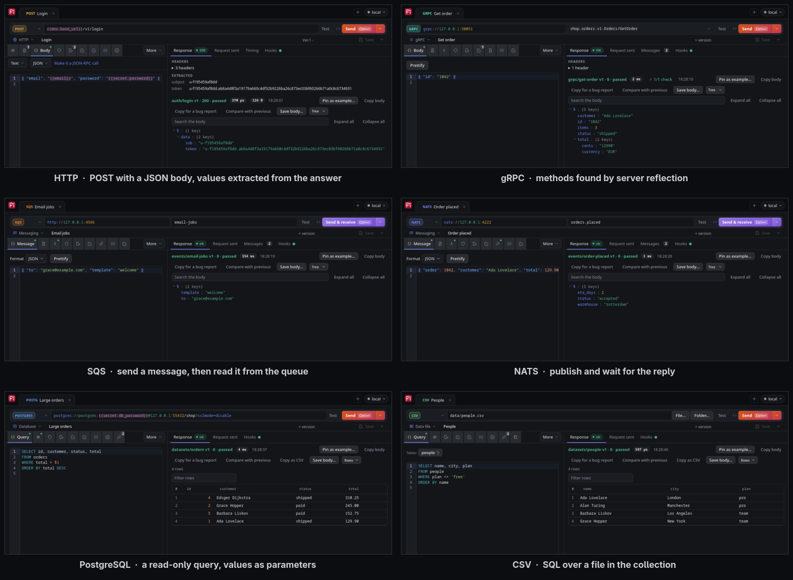
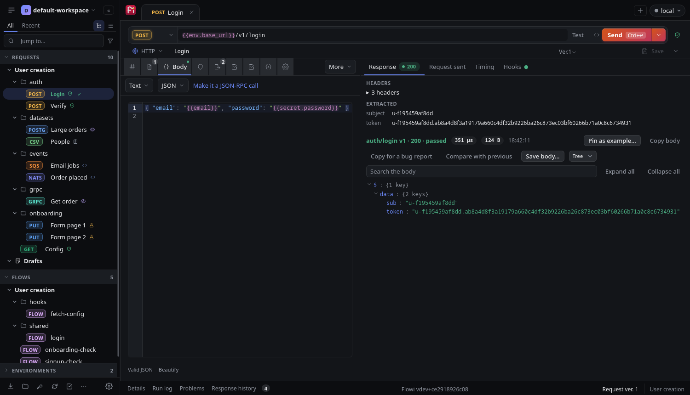
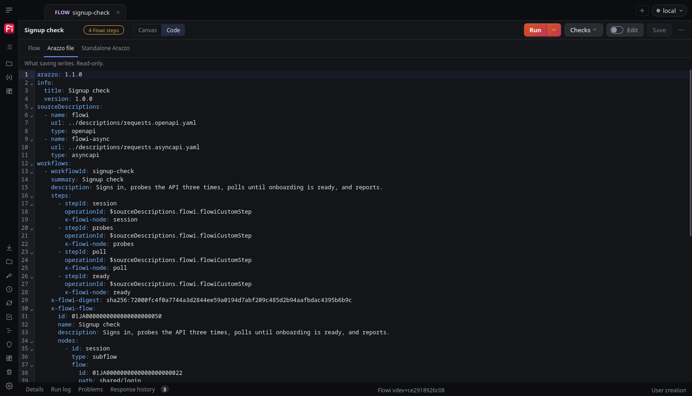
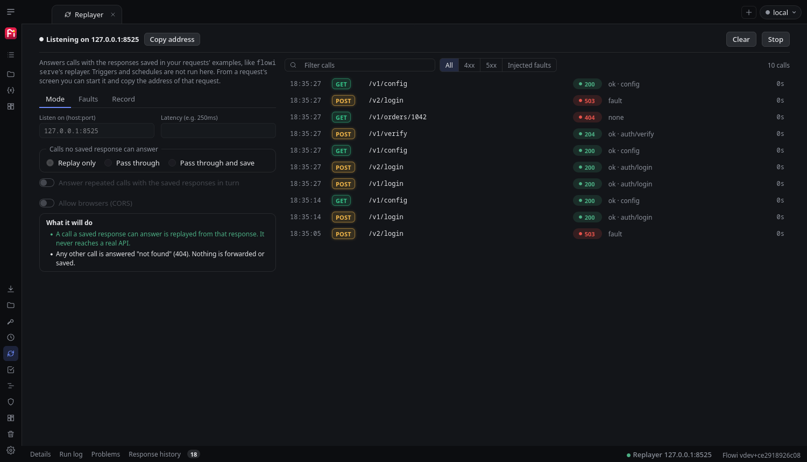
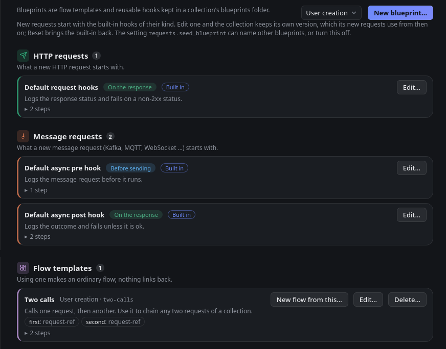
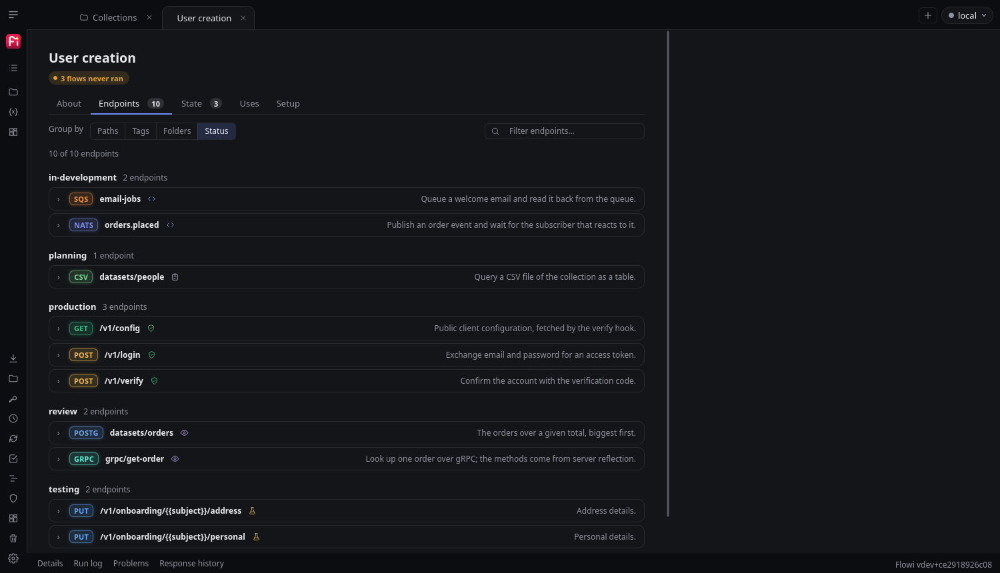

# Flowi

**Test your whole backend from one fast desktop app.** Send HTTP, GraphQL, gRPC, queue and broker messages, database queries and
file queries from the same editor, then chain them into flows that run unchanged in CI. Everything is plain YAML in
your own git repository, and secrets never leave your machine.



## What you can send

| HTTP | GraphQL | gRPC | Messaging | Databases | Data files |
|---|---|---|---|---|---|
| GET | Query | Unary | WebSocket | PostgreSQL | CSV |
| POST | Mutation | Server streaming | Server-Sent Events | MySQL | XLSX |
| PUT | Subscription | gRPC-Web | MQTT | MariaDB | Parquet |
| PATCH | Variables | | Kafka | SQLite | Folder of files |
| DELETE | Named operations | | AMQP 0-9-1 | | |
| HEAD | POST or GET | | AMQP 1.0 | | |
| OPTIONS | | | NATS | | |
| QUERY | | | Redis | | |
| Custom method | | | Amazon SQS | | |
| | | | Amazon SNS | | |
| | | | Azure Service Bus | | |
| | | | Google Pub/Sub | | |

A GraphQL request is an HTTP request with a query, variables and an operation name. An answer with an `errors` list fails
the step even though the status is 200. A subscription opens a WebSocket (`graphql-transport-ws`), waits for the number of
events you set, and shows them like any other message request.

gRPC methods come from server reflection or `.proto` files. Databases and data files are queried with SQL, with values
passed as parameters, and queries only read unless you allow writes.

You can bring in what you already have: OpenAPI, AsyncAPI, `.proto`, Arazzo, Postman, Bruno, Insomnia, HAR, `.http` files and curl
commands.

## Why Flowi

- **Checks that go past HTTP.** Publish an event and wait for the message it causes. Look in the database for the row
  your API wrote. Read a queue. These are requests like any other, so asserts, extracts and hooks work the same way on
  all of them.
- **Whole journeys, not single calls.** Log in, create something, wait for the event, verify it, clean up: draw it as a
  flow and run it with one click. The same file runs in CI with `flowi run`.
- **Fast, and not Electron.** Flowi is a native app with a Go core. It uses your system's own web view instead of
  shipping a copy of Chromium, so it starts quickly, stays light on memory, and big collections stay responsive.
- **Your files, your git.** Collections are plain YAML, so branches, reviews and merges work as they do for code. Flowi
  warns about credentials typed into a request and about secrets headed for the wrong host, before they reach a commit.
- **Built on open standards.** OpenAPI and its overlays, Arazzo workflows, AsyncAPI and OpenTelemetry are used directly,
  not replaced by a private format.
- **Tests without a framework.** A few clicks add an assert to a response. Hooks run before and after a request when you
  need more.

## Requests

One editor covers every kind of request: `{{templates}}` from environments, secrets and generators, several **versions**
of a request, **hooks**, checks on the answer, values extracted from it, pinned examples and a history of responses.
The collage above shows six real answers: an HTTP login whose token feeds the next step, a gRPC call found by server
reflection, an SQS message sent and read back, a NATS request that waits for its reply, a PostgreSQL query with a
parameter, and a SQL query over a CSV file.



A **message request** can send, receive, or both. It subscribes first, sends, then collects the reply, so nothing is
missed. Set how many messages to wait for and a timeout, filter them with a condition, and check or extract values from
them as you would from an HTTP response. A WebSocket or SSE request has an Auth tab like an HTTP one (none, bearer,
basic, an API key, OAuth 2.0, a JWT, a client certificate, or a named authentication): the credential goes on the
connection when it opens, and is masked everywhere it could show.


A **flowi overlay** is a named variant you lay over a request when you send it: the same call as a VIP customer, over a
slow connection, or with a bad token. Flowi shows what it changes before it writes anything.

## Flows

Drag steps onto the canvas, wire them together and press Run. Steps can be requests, asserts, conditions, delays,
subflows, webhooks and more. Dotted arcs show which values pass from one step to the next, and each step turns green or
red as it runs. Open any step to see what it sent and what came back, or run only part of the flow.


The flow above signs in, probes the API three times with a **batch**, polls with **run until** the answer says `ready`,
and asserts the result. Loops are boxes: the steps inside repeat, and the run log shows every round.

Every step has **outcomes**: success and failure to begin with, and you can add your own, such as "401" or "slow". Drag
from an outcome to the step that should run when it happens, so a failed login can lead somewhere instead of stopping
the run. The **Checks** menu runs a flow across a matrix of environments and overlays, checks that another user cannot
reach what the flow made, looks for drift, and draws a sequence diagram of the last run.

Every flow is also a readable file you can edit in the **Code** view, written as an
[Arazzo](https://spec.openapis.org/arazzo/latest.html) workflow so that other tools can read it. Flows export to Arazzo
and Mermaid.



## Replayer

The replayer serves your saved responses as a local API, so a front end can work before the back end exists. Point it at
a real API in *record* mode and it forwards each call, saves the answer and turns calls it has not seen into new
requests. It can also misbehave on purpose, to test retries and error handling: answer a share of calls with an error,
drop the connection or add a delay. A single call can ask for it with a header, such as `X-Flowi-Fault: error:418`.



## Scheduler

Run flows on a cron schedule, each with its own time zone, from the app or without a window with `flowi serve`. The same
server starts a flow when it receives an HTTP call with a trigger token. The screen draws the next runs on a 24-hour
timeline.


## Blueprints

Blueprints are templates. Flow blueprints give you a whole flow to copy and adapt. Hook blueprints give you the steps
you add to many requests, such as signing in first or cleaning up after. Start from one, or save what you built as a
blueprint.



## Drift checking

Flowi learns a schema from the responses it sees. **Check drift** runs a flow and compares every response with it, and
sorts the differences into *missing* (a required field is gone), *changed* (a field has another type) and *new* (a field
the schema does not know). When a change is intended, press **Accept** and the next check measures against the new
shape. The dialog also gives the command that runs the same check in CI.


## Collection governance

Keep a growing collection in order, and catch mistakes while you work.

- **Statuses and tags.** Mark requests, flows and folders as `planning`, `in-development`, `review`, `testing` or
  `production`, and add tags. Both are inherited from the folder. Filter the sidebar with `status:` and `tag:`, and group
  a collection's endpoints by path, tag, folder or status.
- **Secret and credential checks.** Flowi flags a declared secret with no value, a credential typed straight into a
  request instead of a secret (`FLW-LINT-004`), credentials sent over plain `http` (`FLW-LINT-005`), a secret about to
  go to a host it is not allowed for (`FLW-SEC-005`), and secrets in an environment file that ships with the collection
  (`FLW-SEC-006`).
- **API description checks.** Lint rules for imported and generated descriptions, and a warning when a response carries
  `Deprecation` or `Sunset` headers.
- **Impact, coverage and access.** See what uses a request and whether it still fits, how much of an API description
  your flows exercise, and whether another user can reach what a flow made.



## Also included

- **Named authentication.** Define "staging admin" or "partner API" once in the collection's `auths` folder and pick it
  on any request, including a WebSocket or SSE one.
- **Environment comparison.** See every variable of several environments side by side, with differences and gaps
  marked. A secret shows only whether it has a value, never the value.
- **Schema generation.** Flowi writes an OpenAPI or AsyncAPI description from your requests and the schemas it learned.
- **OpenTelemetry tracing.** Send traces of your runs to a collector over OTLP/HTTP. It is off by default and never
  includes bodies, headers or secrets.
- **Encrypted vault.** Secrets are stored encrypted, with the key in the operating system's keychain, and masked
  wherever they could show.
- **Safe imports.** An import shows a preview of every file and writes nothing until you confirm. Credentials become
  secrets, never text in a file.
- **Drafts, a trash, a command palette and themes**, including a high-contrast one.


## Install

Download the package for your system from the [releases page](https://github.com/githugt/flowi/releases).

- **macOS:** unzip `flowi-app_*_macos_arm64.zip` and open `flowi-gui.app`. The app is not notarized yet: right-click and choose Open the first time.
- **Windows 10 or later:** run `flowi-app_*_windows_amd64_setup.exe`. The installer is not signed yet, so SmartScreen warns first.
- **Debian 13 or Ubuntu 24.04 or later:** `sudo apt install ./flowi-app_*_linux_amd64.deb`
- **Fedora:** `sudo dnf install ./flowi-app_*_linux_amd64.rpm`
- **Arch, CachyOS, Manjaro:** `sudo pacman -U flowi-app_*_linux_amd64.pkg.tar.zst`

The command is `flowi-app`. To build it yourself, see the [app README](app/README.md), which also lists what the
window needs on Linux.

To try it with data, mount the example collection in [`lib/examples`](lib/examples) (the folder icon in the sidebar)
and start its demo server.

## Command line and library

**[`cli/`](cli)** is the `flowi` command, one static binary. It runs the same collections and flows in CI or on a server:
`flowi send` and `flowi run` (with JUnit, JSON and Markdown reports), `flowi drift`, `flowi impact`, `flowi coverage`,
`flowi access`, `flowi secret check` to fail early on a missing secret, `flowi import` and `flowi export`, `flowi serve`
for schedules, triggers and the replayer, and `flowi merge-driver install` so that git can merge flow files.

```bash
go install github.com/githugt/flowi/cli/cmd/flowi@latest
flowi run user-creation --env staging --report junit=report.xml
```

**[`lib/`](lib)** is the Go library both are built on: collections, requests, flows, transports, the vault and the
importers, with no user interface and no cgo, for embedding in your own programs. See its [README](lib/README.md) and
the [development guide](lib/docs/development.md).

## Working in the repository

`go.work` links the three modules, so a change in `lib/` shows up in `cli/` and `app/` straight away. From the root:

```bash
just run         # start the app
just check       # tidy, lint and test every module
```

Each part is tagged on its own, with its folder as a prefix: `lib/v0.4.1`, `cli/v0.4.1-alpha.1`,
`app/v0.4.1-alpha.1`. A `cli/` or `app/` tag builds and publishes that part's release.

## Licence

The app and the command line are AGPL-3.0-or-later and the library is Apache-2.0. Each folder's `LICENSE` file applies
to that folder.
