# Flowi

A desktop app for exploring APIs and stitching requests into **flows**: log in, take the token, verify, fill
in a form, check the result, and run the whole journey with one click. Your work is plain YAML files in your own
git repository; secrets stay in an encrypted local vault.

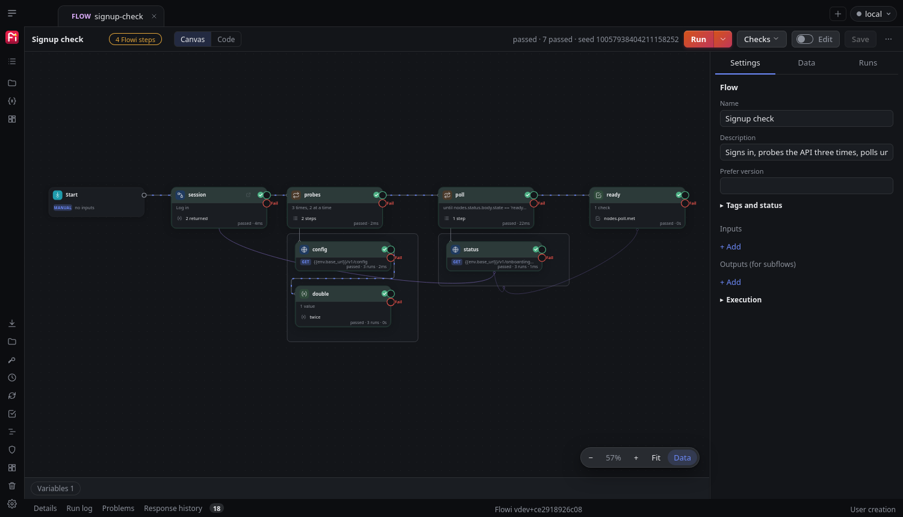

Flowi is one repository with three parts: this app (`app/`), the [command-line tool](../cli) that
runs the same collections in CI, and the [core library](../lib) both are built on. The
[repository README](../README.md) has the overview, including the full table of what Flowi can talk to.

## Why

Most API tools stop at the single request, and most of them stop at HTTP. Real work is a sequence that crosses
protocols: call an API, wait for the event it publishes, look in the database for the row it wrote. The sequence is what
breaks when an API changes. Flowi keeps requests as reusable building blocks, draws the sequences, runs them, and tells
you what a change to a request would break.

It is meant to stay fast. The core is Go, and the window shows its screens in the system's own web view (WKWebView,
WebView2 or WebKitGTK) instead of bundling a browser, so large collections open quickly and a request is sent
the moment you press Send. And it is meant to live in git: files are plain YAML, so branches and reviews work as they do
for code, and Flowi checks for credentials typed into requests and for secrets that would go to the wrong host, so they
are not pushed by mistake.

## What you can do

### Explore an API

Build and send HTTP and gRPC requests. Use `{{templates}}` from environments, secrets and generators, keep several
**versions** of a request, attach pre and post **hooks**, add checks on the answer (status, headers, a field of the
body, a schema) and pin a response as an example. Responses show as a tree, with timing, the exact request sent, a
history and a comparison with the previous answer. Copy a request as curl and other snippets. Besides the
usual methods you can use `QUERY` or any method of your own. gRPC methods come from server reflection or from `.proto`
files.

A **flowi overlay** is a named variant you lay over a request when you send it: the same call as a VIP customer, with
a slow connection, or with a bad token. Save one from what you have on screen, and Flowi shows what it changes before
it writes anything.

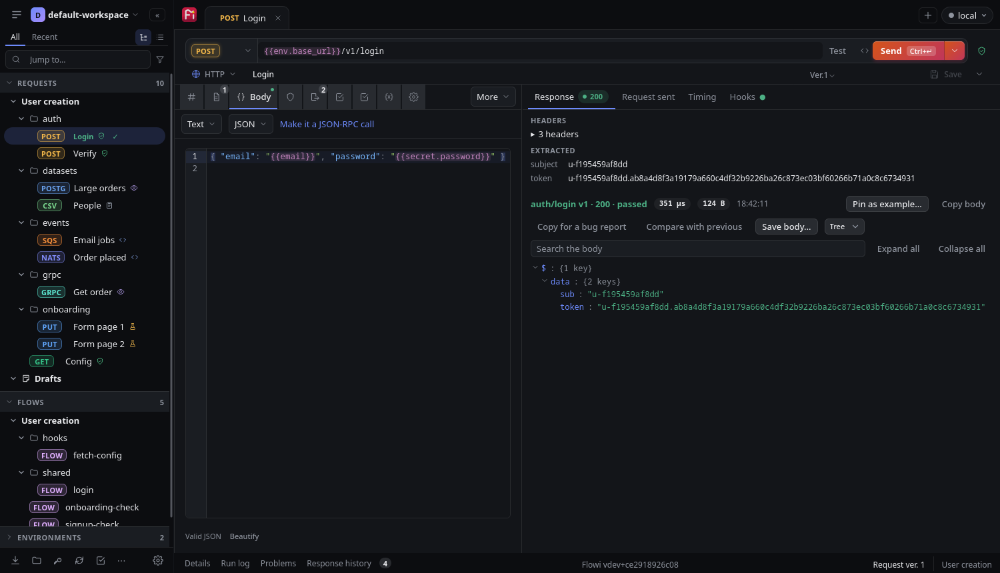

### Send and receive messages

Event-driven APIs get the same editor. Publish to or listen on **Kafka, MQTT, AMQP, NATS, Redis, SQS, SNS, Google
Pub/Sub, Azure Service Bus, WebSocket and Server-Sent Events**. A request can send, receive, or both: it
subscribes first, sends, then collects the reply, so nothing is missed. Choose how many messages to wait for and a
timeout, filter them with a condition, and check or extract values from what arrives, exactly as for an HTTP
response. Message requests are steps in flows too: publish an event, then wait for the message it causes.
Each run connects, does its work and closes.

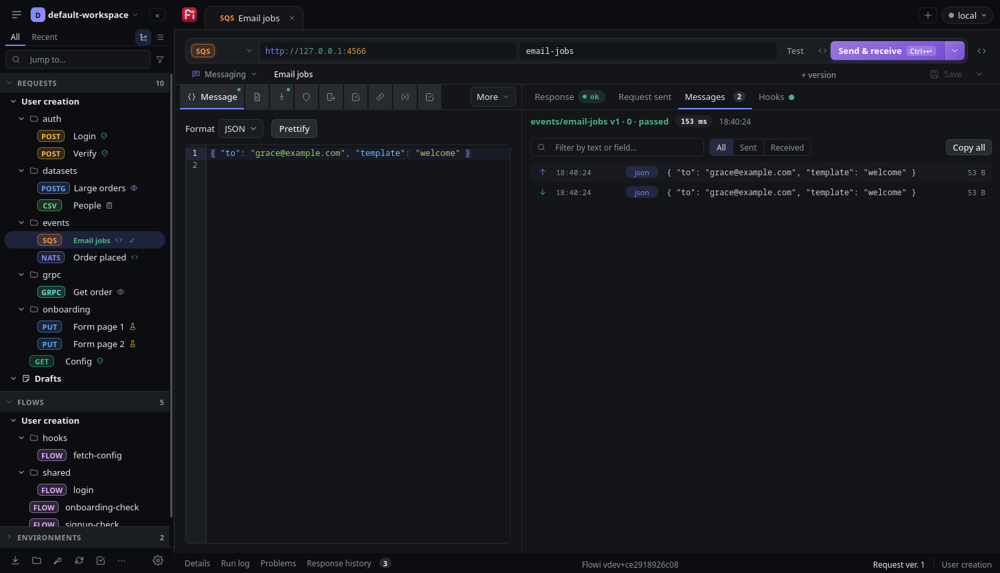

### Query a database or a data file

A request can also be a query: PostgreSQL, MySQL, MariaDB or SQLite, or a CSV, XLSX or Parquet file (or a folder of
them) in your collection. Write the SQL, give its values as parameters, and see the rows in a table. A query only reads,
and a flow's request step can run it like any other request, so a flow can check what an API wrote.

The same editor, with the same response panel, checks and hooks, covers every kind of request:

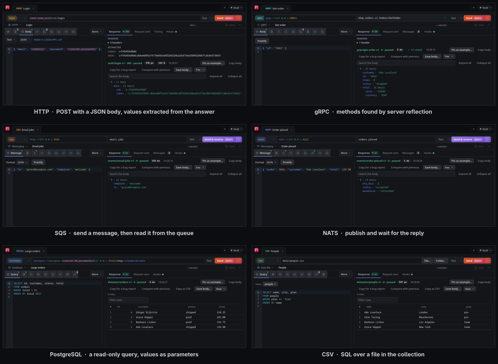

### Build flows on a canvas

Drag steps onto the canvas: request, fetch, webhook, subflow, set, assert, fuzz, condition, delay, batch, parallel,
run until, log, note and more. Dotted arcs show which values pass from one step to another. Run the flow and watch each
step turn green or red, then open what it sent and what came back, or run only part of it.

**Loops are boxes.** A *batch* box repeats the steps inside it over a list, a number of times, or both at once, with a
limit on how many run together. A *run until* box repeats them until a condition holds, for example until a status
field says `ready`, with a limit and a pause between rounds. In the flow above, the first box probes the API three times
and the second polls until the onboarding is ready.

Every step has **outcomes**: success and failure to begin with, and you can add your own, such as "401" or "slow".
Drag from an outcome to the step that should run when it happens, and click an arrow to say whether it fires on
success, on failure or on either. That is how a flow handles a failed login without stopping. The **Checks** menu
runs a flow across a matrix of environments and overlays, checks that another user cannot reach what the flow made,
looks for drift from the responses seen before, and draws a sequence diagram of the last run.

### Arazzo and the file view

Every flow is a readable YAML file you can edit in the **Code** view. The same flow is also written as an
[Arazzo](https://spec.openapis.org/arazzo/latest.html) workflow, so other tools can read it, and Flowi can
export flows as Arazzo or as a Mermaid diagram for docs.

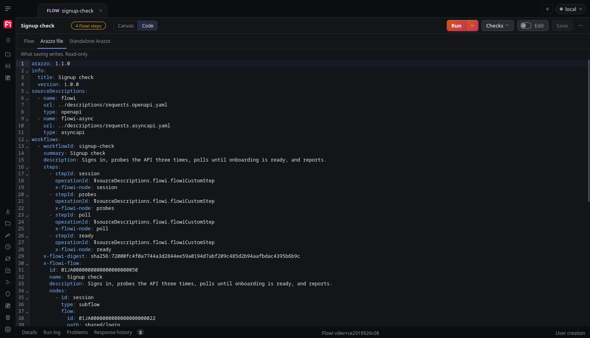

### Import what you have

Bring in OpenAPI, AsyncAPI, `.proto`, Arazzo, Postman, Bruno, HAR, `.http` files and curl commands. You see a
preview of every file first, and nothing is written until you confirm. Credentials are turned into secrets, never
copied into files.

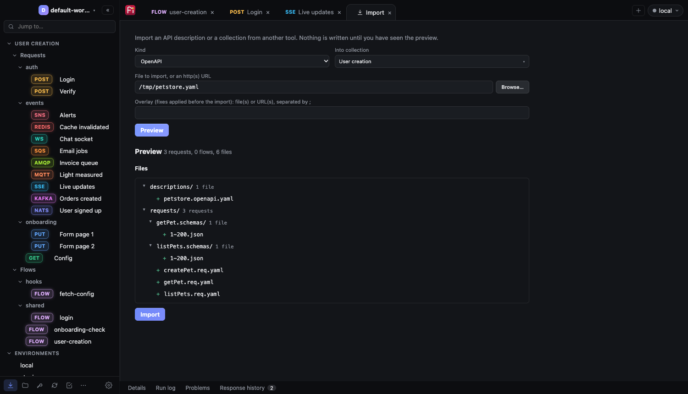

### Fake an API with the replayer

Serve your saved responses as a local API, so a front end can work before the back end exists. Or point it at a
real API to **record**: it forwards each call, saves the answer, and turns calls it has not seen into new requests.
It can also misbehave on purpose, to try retries and error handling: answer a share of calls with an error, drop the
connection, or add a random delay. One call can ask for it with a header, such as `X-Flowi-Fault: error:418`.
In the list of calls, filter by status or by the faults it injected.

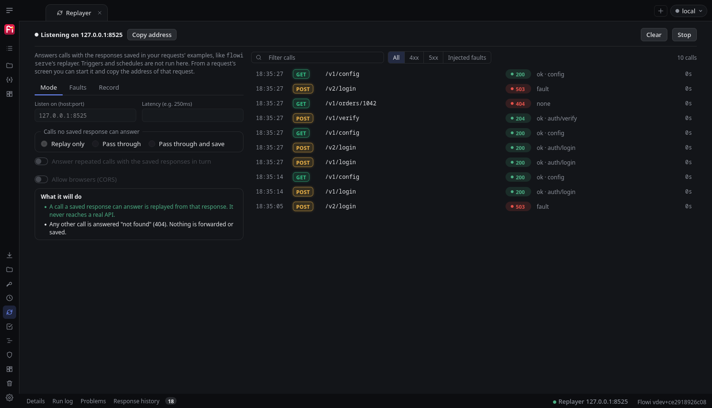

### Run flows on a schedule

Add cron schedules, each with a time zone, and start them from the app, or run them without a window with
`flowi serve`. The next runs are drawn on a 24-hour timeline. Flows can also be started by an HTTP call with a trigger
token, which you make on the same screen.

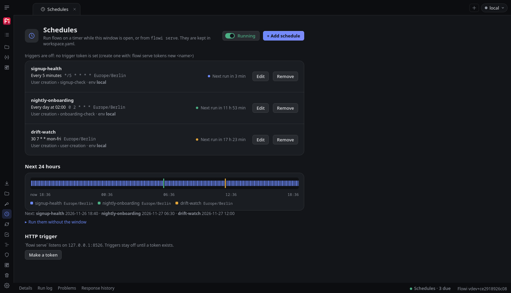

### Start from a blueprint

A **blueprint** is a template. Flow blueprints give you a whole flow to copy and adapt; hook blueprints give you the pre
and post steps you use again and again, such as signing in before a request or cleaning up after it. Create from one, or
save what you built as a blueprint.

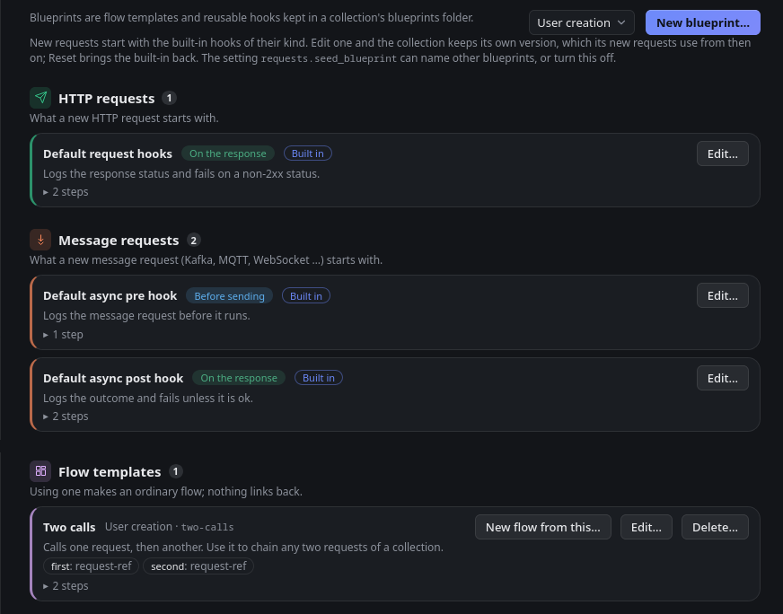

### Check for drift

Every response Flowi sees teaches it a schema. **Check drift** runs a flow and compares each response with the schema
stored for it: fields the schema does not know are *new*, required fields that are gone are *missing*, and fields of
another type are *changed*. Press **Accept** on a request to take the new shape as the baseline. The dialog also gives
the `flowi drift` command to run the same check in CI.

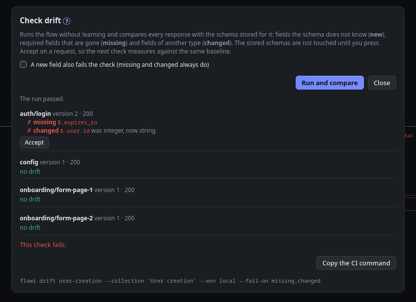

### Keep the collection in order

A collection's page shows what it holds and what state it is in. Give requests, flows and folders a **status**
(planning, in-development, review, testing, production) and **tags**; both are inherited from the folder, filter the
sidebar (`status:review`, `tag:billing`), and group the collection's endpoints by path, tag, folder or status.

Checks run while you work and say what is wrong in plain words: a secret with no value, a credential typed straight
into a request instead of a secret, credentials sent over plain `http`, a secret that would go to a host it is not
allowed for, a secret in an environment file that ships with the collection. For imported API descriptions there are
spec lint rules, a coverage check (how much of the API your flows use) and a spec-change check (what a newer
description would break). Responses with `Deprecation` or `Sunset` headers are flagged.

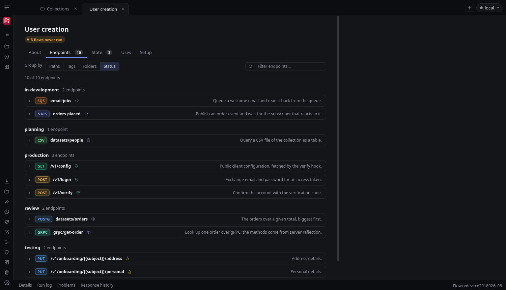

### Environments, secrets and authentication

**Environments** hold plain variables and secrets. Compare several side by side: a value that differs is tinted, a
missing one is marked, and a secret only shows whether it has a value in the vault, never the value. Secrets live in an
encrypted local vault with the key in the operating system's keychain, and they are masked wherever they could show.
**Named authentications** (kept in the collection's `auths` folder) define how to sign in once, for any request to use.

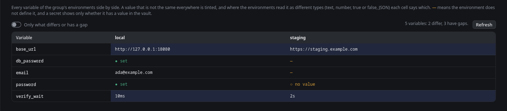

### And more

**Impact analysis** of what uses a request; **schema generation**, which writes an OpenAPI or AsyncAPI description from
your requests and the schemas learned from their answers; **OpenTelemetry tracing** of runs, off by default and never
including bodies, headers or secrets; drafts you can try things in before saving; a trash for abandoned drafts; a
command palette; themes, including a high-contrast one; and a settings screen where every setting is explained.

## Install a release

Download the package for your system from the [releases page](https://github.com/githugt/flowi/releases).

- **macOS:** unzip `flowi-app_*_macos_arm64.zip` and open `flowi-gui.app`. The app is not notarized yet: right-click and choose Open the first time.
- **Windows 10 or later:** run `flowi-app_*_windows_amd64_setup.exe`. The installer is not signed yet, so SmartScreen warns first.
- **Debian 13 or Ubuntu 24.04 or later:** `sudo apt install ./flowi-app_*_linux_amd64.deb`
- **Fedora:** `sudo dnf install ./flowi-app_*_linux_amd64.rpm`
- **Arch, CachyOS, Manjaro:** `sudo pacman -U flowi-app_*_linux_amd64.pkg.tar.zst`

The Linux packages install what the window needs, so you do not have to. The command is `flowi-app`: `flowi` is the
command line tool. If you run the program some other way
(built from source), install these yourself. The window refuses to start without them and tells you what is missing:

| System | Packages |
|---|---|
| Arch and derivatives | `sudo pacman -S gtk4 webkitgtk-6.0 libsoup3 bubblewrap xdg-dbus-proxy` |
| Debian 13, Ubuntu 24.04 and later | `sudo apt install libgtk-4-1 libwebkitgtk-6.0-4 libsoup-3.0-0 bubblewrap xdg-dbus-proxy` |
| Fedora | `sudo dnf install gtk4 webkitgtk6.0 libsoup3 bubblewrap xdg-dbus-proxy` |

`bubblewrap` and `xdg-dbus-proxy` are what WebKit runs web content under. There is no AppImage: WebKitGTK has
the Debian and Ubuntu paths of its helper programs built in, so an AppImage built on Ubuntu starts only there.

## Install and run

You need [Go](https://go.dev/dl/) 1.27 or later, [Node.js](https://nodejs.org/) 22 or later and
[just](https://github.com/casey/just). On Linux also `libgtk-4-dev` and `libwebkitgtk-6.0-dev`; on macOS the
Xcode command line tools; on Windows the WebView2 runtime.

```bash
git clone https://github.com/githugt/flowi && cd flowi/app
just run          # build the front end, then start the app
just build        # or build a binary into ./bin/flowi-app
```

### Supported systems

- **Windows 10 or later, 64-bit.** Windows 7, 8 and 8.1 do not work, for two reasons: programs built with Go 1.21
  or later need Windows 10, and the window uses Microsoft's WebView2, which no longer supports those versions.
- **macOS and Linux:** a release that is still supported by its vendor. The app shows its screens in the system's own
  web engine instead of bundling one (WKWebView on macOS, WebKitGTK 6.0 with GTK 4 on Linux). On Linux that means a
  distribution that ships those libraries, such as Ubuntu 24.04, which is what the tests run on.

`go install` does not work for this app: the web front end is built from source and embedded in the binary.

`FLOWI_CONFIG_DIR` points the app at another config folder, so you can try it without touching your own
workspace. To see it with data, mount the example collection in
[the library's examples](../lib/examples) (the folder icon in the sidebar) and start
its demo server.

## Develop

```bash
just check        # tidy, lint, Go tests with the race detector, svelte-check and the front end's unit tests
just bindings     # regenerate frontend/bindings after changing a service's Go methods (needs wails3)
```

See [`AGENTS.md`](AGENTS.md) for the rules the code follows. The screenshots in this file are taken from the browser
build of the front end (`go build -tags server`) over a made-up collection and local test backends; they contain no real
names, paths or secrets.

## Licence

AGPL-3.0-or-later. See [`LICENSE`](LICENSE).
